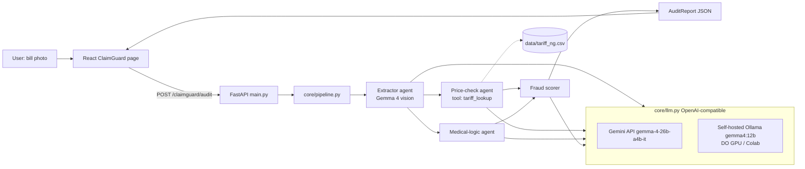

# ClaimGuard — Architecture (built on agent-factory)

## Existing agent-factory (as found, commit 56a667a, Aug 21 2026)
- FastAPI `main.py`: `/health`, `/supervisor` (LLM routes prompt to a profile), `/run/{profile}`, `/upload` (Chroma RAG); auth via `FACTORY_MASTER_KEY` header.
- `core/chassis.py` `AgentChassis(profile_name)`: loads `profiles/<name>.yaml` (personality.system_prompt + tools), builds LangGraph `create_react_agent`, LLM via `core/llm.py` (`LLM_BASE_URL` / `LLM_API_KEY` / `LLM_MODEL`).
- Tools: `tools/` registry dict in chassis + optional `mcp_servers.<module>.<func>` dynamic loading.
- React+Vite dashboard in `frontend/`, Dockerfile.

## Upgrades (minimal, backwards compatible)
1. **`core/llm.py`** – provider-agnostic factory: `get_llm()` returns `ChatOpenAI(base_url=LLM_BASE_URL, api_key=LLM_API_KEY, model=LLM_MODEL, temperature=0)` with optional fallback (`LLM_FALLBACK_BASE_URL/KEY/MODEL`) and legacy Groq as last tier. `chassis._initialize_llm_routing` calls it. Also `vision_json(prompt, image_b64)` helper.
2. **Profile `model:` override** – YAML may set `model:`; chassis passes it to `get_llm`.
3. **`core/pipeline.py`** – deterministic multi-agent pipeline (not supervisor routing): extractor → (price_checker ‖ medical_logic) → fraud_scorer. Built with `asyncio.gather`; each step = one AgentChassis profile or a direct JSON call.
4. New profiles `profiles/10_cg_extractor.yaml … 13_cg_fraud_scorer.yaml`, tools `tools/tariff_lookup.py`, data `data/tariff_ng.csv`.
5. Endpoint `POST /claimguard/audit` (multipart image) → AuditReport JSON. Frontend page `frontend/src/ClaimGuard.jsx`.

## Data flow
1. Image (≤5 MB) → resized ≤1280px → base64.
2. Extractor returns `ExtractedBill` (patient-anonymised: names masked with existing `pii_regex_masker`).
3. Price-check: deterministic CSV match (rapidfuzz/difflib) per line → overcharge % ; LLM only explains unmatched items.
4. Medical-logic: diagnosis vs. items → `fit: ok|questionable|unrelated` per line.
5. Fraud scorer: rules first (overcharge >30%, duplicate lines, qty implausible, unrelated item, arithmetic total mismatch) → score 0–100, then LLM writes the summary. Verdict: `APPROVE` (<30) / `REVIEW` (30–69) / `REJECT` (≥70).

Rules are computed in Python so the verdict is reproducible; Gemma does perception + reasoning text. Schemas in agent.md.

## Model switch
| env | Gemini API | Self-host |
|---|---|---|
| LLM_BASE_URL | https://generativelanguage.googleapis.com/v1beta/openai/ | http://IP:11434/v1 |
| LLM_MODEL | gemma-4-26b-a4b-it | gemma4:12b |

## Deployment
- Backend: existing Dockerfile → DigitalOcean App Platform (or $6 droplet). Secrets as encrypted env vars.
- Frontend: Vercel, `VITE_API_URL`.
- Model: Gemini API primary; DO RTX 4000 GPU droplet ($0.76/h) for open-weights demo. See gemma.md.
- Security: `.env` gitignored, `FACTORY_MASTER_KEY` on all write endpoints, no real patient data (synthetic bills only).
